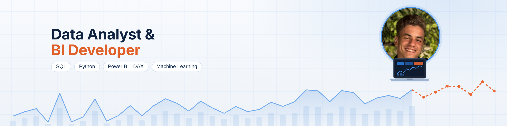

## Hi, I'm Wissem 👋

Data Analyst and BI Developer with a Bachelor's degree in **Big Data & Data Analysis**.
I turn raw business data into dashboards, models and recommendations that teams can act on,
using **SQL, Python and Power BI**.

- 📊 I build end-to-end analytics: data cleaning → modeling → dashboards → business recommendations
- 🤖 I add machine learning where it helps a decision: segmentation, forecasting, churn and risk scoring
- ✅ I care about data quality: every project starts with automated checks
- 🌍 English (C1), French (fluent), Arabic (native) · open to relocation

---

### 🚀 Featured projects

| Project | What it answers | Stack |
|---|---|---|
| **[Sales Intelligence: Power BI + ML](https://github.com/Wissem02/sales-intelligence-powerbi-ml)** · [live dashboard](https://wissem02.github.io/sales-intelligence-powerbi-ml/dashboard/) | Where is profit lost on $109.8M of sales, which customers matter, and what revenue to plan for? Found reseller bike sales running at a **-1.5% margin**; forecast backtested at **12% error** | Power BI, DAX, Python, K-Means, forecasting |
| **[Customer Churn Prediction](https://github.com/Wissem02/customer-churn-prediction)** | Which of 7,043 telecom customers will leave, and why? A high-risk list of **34% of customers captures 72% of churners** | Python, Scikit-learn, classification |
| **[Sales Performance Analysis in SQL](https://github.com/Wissem02/sales-performance-sql)** | Why did revenue stop growing across 609K order lines? Data quality checks caught **$8.3M of test-account orders** | SQL, CTEs, window functions |
| **[Credit Risk Scoring + Data Quality](https://github.com/Wissem02/credit-risk-data-quality)** | Can loans be scored on data we trust? **34 automated quality rules**; cost-sensitive cut-off cuts misclassification cost by **41%** | Python, logistic regression, data quality |

---

### 🛠️ Tech stack

**Analytics:** data modeling (star schema) · ETL with Power Query · DAX · KPI design · statistics · data quality
**Machine learning:** classification · clustering · time-series forecasting · model evaluation

---

### 💼 Experience

- **Customer Relationship & Data Analyst** · Level1 · 2024: Power BI dashboards, client portfolio analysis in Excel, ML models in Python
- **Data Analyst Intern** · Vectorys · 2024: Power BI dashboards integrated into the company's information system, Power Query ETL, star schema, DAX
- **DevOps Intern** · Vermeg · 2022: CI/CD pipelines on Azure DevOps

---

### 📫 Contact

- ✉️ **cwissem212@gmail.com**
- 💼 [LinkedIn](https://www.linkedin.com/in/YOUR-LINKEDIN-ID)
- 📍 France · Germany · open to relocation in Europe

*Open to Data Analyst and Business Intelligence roles.*
